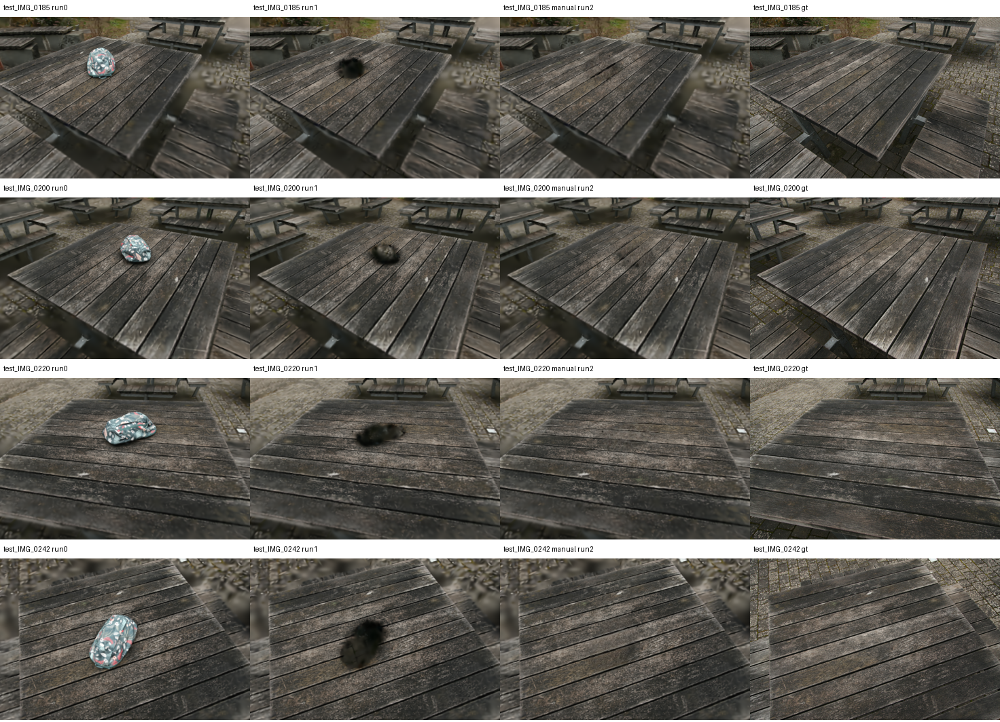
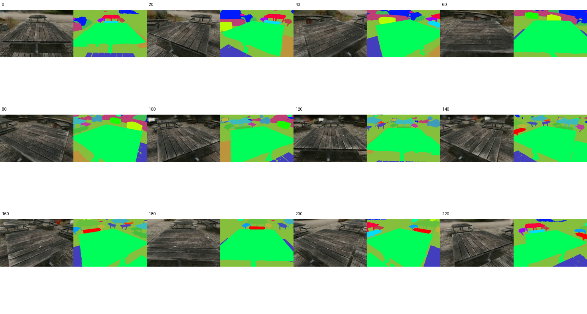

# bag 人工 Mask 修复基线

2026-10-13：用户完成 30 帧标注与跟踪，并确认无明显漂移。原始 palette
标签 0/1 经过官方预处理得到 0/255 二值 mask；全部非空，扩张后每帧
9565–12207 个修复像素。首帧、中间和末帧人工抽查覆盖黑斑。

## 对照与结果

冻结对象感知 iteration_2000 checkpoint、ID 29 和删除阈值 0.7。在官方
`inpaint_setup` 执行前核对实际删除集合：208987 个源 Gaussian 中删除 7616 个，
与正式 Run 1 的冻结 mask 逐元素完全一致（见 `deletion_gate.json`）。
没有修改 LaMa、损失函数、纹理算法或优化参数；仍为低分辨率因子 8 和 5000 步修复。

| 模型 | 修复区 PSNR | 非修复区 PSNR | 全图 PSNR |
|---|---:|---:|---:|
| 仅删除 | 9.958 | 26.934 | 23.972 |
| 人工 Mask 官方修复 | 18.484 | 27.610 | 27.027 |

58 个清场相机、相同 GT 和评测 mask，严格有效像素 MSE 对应 PSNR，单位 dB。
这是像素加权结果，不是 mask 外置零整图指标。GT 为官方相机加载并缩放的真实
清场图像；mask 最近邻缩放，详见 `regions.json`。

抽查四视角黑斑消除、桌面板缝整体延续；仍有木纹细节模糊和局部色差。
相比旧自动 mask 修复的 19.10 dB，本次修复区为 18.48 dB；本轮不据此修改算法。
人工 mask 范围不同，单次差异也不能推导某一种标注方法普遍更优。

## 进度与边界

单目标、同删除集合的人工修复闭环已运行并得到量化改善。已完成逐视角指标
检查及轨迹抽样检查；用户已确认动态验收通过，MVP-B 也已完成并通过动态验收。
当前低分辨率与短基础训练结果也不能当作论文质量复现。

优化及官方后续渲染共 153.1 秒，PyTorch 峰值 allocated 约 1.48 GiB、reserved
约 1.81 GiB（见 `runtime.json`），不是整条管线耗时或整卡峰值显存。

远端独立实验目录：`output/mvp-bag-manual-20261013`。旧实验未覆盖。
原始人工 mask 快照与哈希、处理后 mask 统计、分步日志均在该目录。
轨迹视频：`model/video/ours__object_inpaint_virtual/iteration_5000/final_video.mp4`。
修复 PLY：`model/point_cloud_object_inpaint_virtual/iteration_5000/point_cloud.ply`。

## 逐视角及轨迹审查

58/58 清场视角修复区 PSNR 均提高，增益 6.10–10.06 dB；最小增益视角为
`test_IMG_0200`，已包含于四列对比图。非修复区也是 58/58 改善，增益
0.137–1.704 dB。区域平均改善不能排除个别局部纹理退化。

视频 240 帧、30 fps，逐帧成功解码。每 20 帧抽查一次环绕图，未见大面积
空洞或目标重新出现；尚不能凭抽样排除短暂闪烁。官方视频左右分别为 RGB
与对象标签，额外导出 RGB-only 的 `rgb_review.mp4` 供用户检查。

当前判断：MVP-A 的受控定量与动态视觉闭环均已通过，值得继续；
不宣称高保真背景交付完成，也不由此推导多目标修复可行。

已验收视频：[RGB-only 轨迹](rgb_review.mp4)。

## 用户动态验收

用户已检查 240 帧轨迹的时间轴抽帧和帧间一致性，确认无明显目标重现、
大面积黑斑、板缝突然跳变或整体亮度闪烁。MVP-A 动态视觉验收通过，
局部模糊和纹理误差暂不阻塞流程验证；用户同意进入 MVP-B。

## 带物体留出视角补查

另已渲染 13 个带物体留出相机的 Run 0/1/2，见 holdout-manifest.json。图像保存在远程 output/mvp-bag-manual-20261013/holdout-comparison-v2/。它们与 58 个清场相机分开记录，不作为清场 GT。
