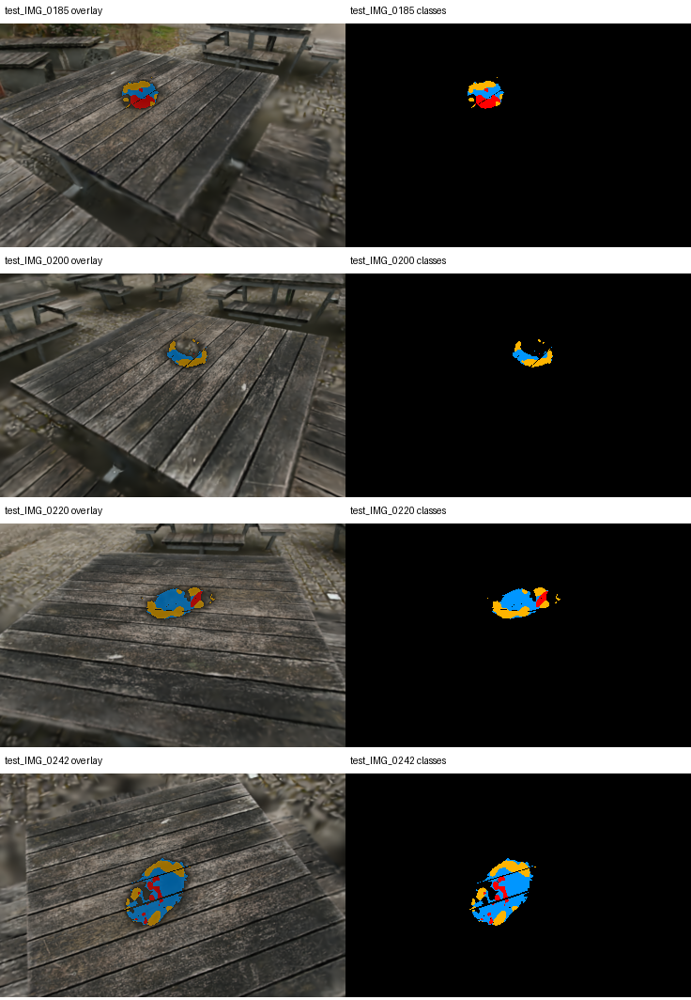
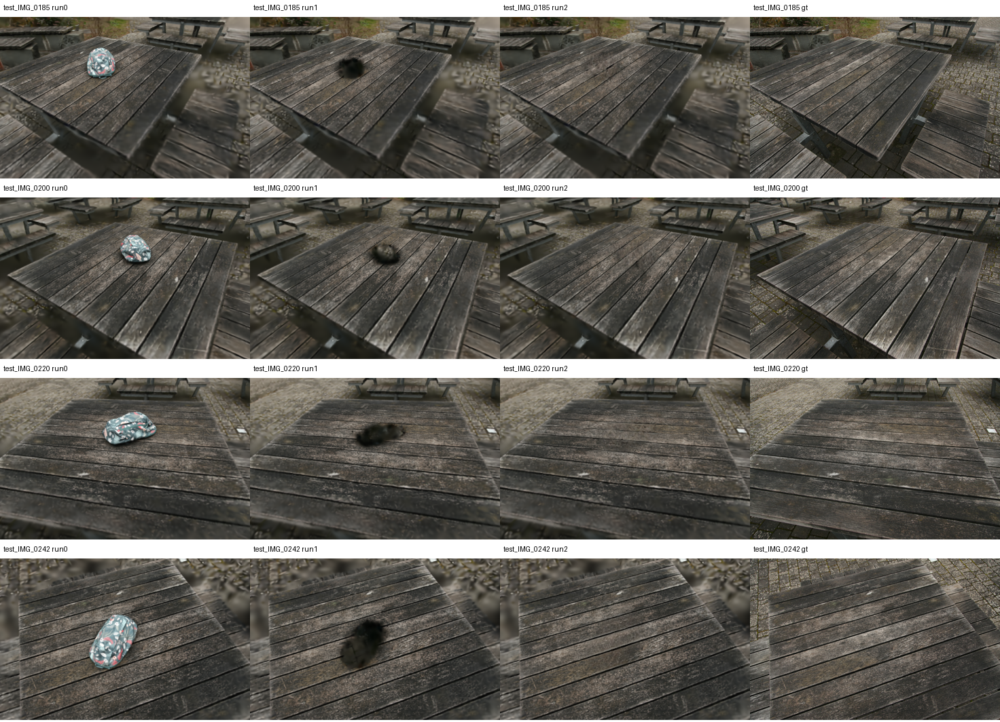

# bag 探索实验：2026-10-13

状态：工具开发及初步评测完成；官方人工 mask 基线尚未验收。

用户已确认删除目标基本正确，要求继续正式基线，暂不改修复算法或优化纹理。

## Run 1 黑斑诊断

诊断覆盖 58 个清场相机。候选暗区定义为目标删除前投影区域中 RGB 均值小于
0.15、且比 GT 暗至少 0.12 的像素；这是可复核的启发式，不是几何 GT。

- 6952 像素（7.7%）：累积 opacity < 0.8，支持删除后暴露覆盖不足/空洞解释。
- 32269 像素（35.6%）：opacity 较高，且残存弱目标特征 Gaussian 的 alpha > 0.1。
  这是残余目标贡献的候选证据，亦可能是目标污染的背景 Gaussian，未确认属于目标。
- 51452 像素（56.7%）：opacity 较高，弱目标贡献未达上述阈值，支持原背景重建
  暗色/欠约束解释；不能凭该分类判断真实背景可见性或几何正确性。

剩余 Gaussian 中 ID 29 概率 > 0.7 的数量为 0，> 0.1 的数量为 42。
不能把“无高概率目标”当作彻底无残余的证明。渲染加权深度已保存，仅作证据，
不视为真实表面深度。远端每视角保存类别 mask、opacity、深度、弱目标 alpha。

汇总在 `black_regions.json`，远端路径为 `output/mvp-bag-20261013-black-diagnostics`。

服务器为 `ypk@172.16.88.217`，项目真实路径为 `/mnt/data/ypk/Projects/Inpaint360GS`。
复用已有低分辨率、短训练实验，不能与论文结果直接比较。

## 已验证

- 从对象感知 iteration_2000 checkpoint 重算 ID 29 的阈值、凸包和最终掩码。
- 删除 7616 / 208987 个 Gaussian，留下 201371 个；逐行、逐字段精确复现已有删除 PLY。
- 对 Run 0、Run 1、已有 Run 2 渲染相同的 58 个清场相机，分辨率因子为 8。
- 用官方相机加载后的真实图像作为 GT；原始二值 mask 显式最近邻缩放到评测尺寸。
- 严格按有效像素计算修复区、非修复区及全图误差，未使用置零整图 PSNR。

| 模型 | 修复区 PSNR | 非修复区 PSNR | 全图 PSNR |
|---|---:|---:|---:|
| Run 0：对象感知模型 | 11.66 | 24.88 | 23.42 |
| Run 1：仅删除 | 9.96 | 26.93 | 23.97 |
| 已有 Run 2：自动 mask 修复 | 19.10 | 27.55 | 27.06 |

表中数值为像素加权 MSE 对应的 PSNR，单位 dB。修复区 MSE 由 0.10096 降至
0.01230，减少约 87.8%。58 视角缩放后修复区占约 2.00%，不是第一张原始
mask 的 0.76%；单视角二维面积不能推导整个场景真实未观测区域很小。

视觉检查：仅删除留下明显黑色缺失；已有修复填入桌面颜色和纹理，但原袋子区域
仍模糊，板缝和木纹细节未达到真实参考的保真程度。未见所选四视角发生大面积
周围桌面丢失；这不构成全部 Gaussian 的背景归属证明。

## 尚缺的验收证据

已有 Run 2 使用虚拟视角渲染差异生成自动 mask（阈值 18、7×7 闭运算、最大
连通区域、扩张 10 像素），不是官方人工跟踪基线。没有保存当时修复阶段的
实际删除掩码，不能仅凭算法相同就断言 Run 1/Run 2 输入集合完全一致。

下一步：人工确认目标和虚拟视角修复区域，冻结输入，重新记录修复阶段删除
集合并与 Run 1 逐元素比较；完成官方人工流程后再做正式 MVP-A 验收。自由视角
视频、运行耗时和优化峰值显存也需在该次运行记录。MVP-B 尚未开始。

## 产物

本目录保存 `manifest.json`、`removal_report.json`、`regions.json`、`regions.csv`
及对比图。远端新增输出为 `output/mvp-bag-20261013-removal`、
`output/mvp-bag-20261013-renders` 和 `output/mvp-bag-20261013-metrics`。
现有部署和旧实验输出未覆盖。实现位于 `scripts/mvp/`。
