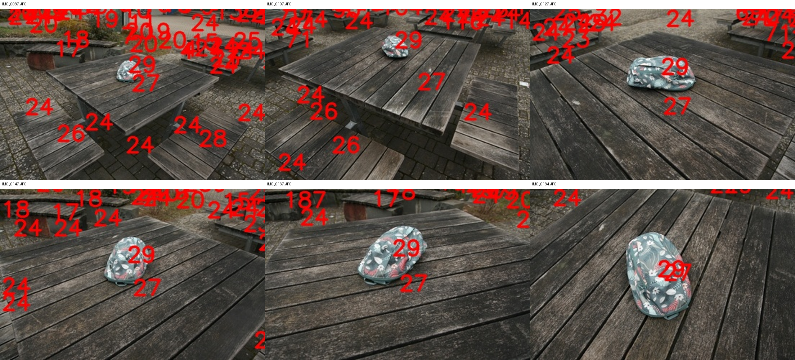
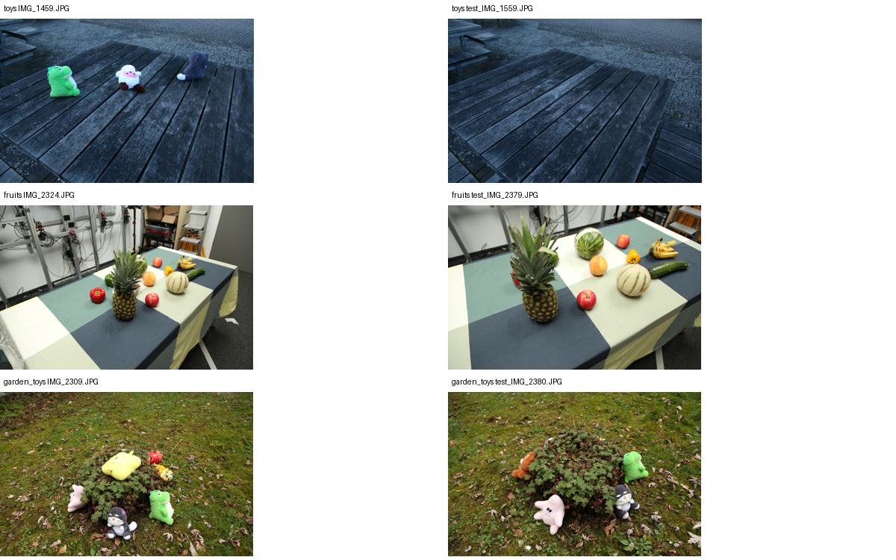

# MVP-B 目标准备

MVP-A 已获用户动态视觉验收通过。多目标实验尚未开始删除。

抽查 bag 的六个原始标号视角，袋子对应 ID 29，桌面主要对应 ID 27，长凳
对应 ID 26。当前没有识别出第二个明确的独立干扰物；不同编号不自动等于
适合删除的不同物体，桌面/长凳也不能未经用户指定就当作干扰物。

bag 清场参考支持袋子删除，不能支持桌面或长凳删除后的真实性评测。
如果用户明确指定删除建筑/家具对象，仍可做多目标删除与视觉连续性实验，
但不能宣称所有隐藏背景恢复均有 GT。当前等待额外目标指定或调整数据范围，
不将桌面拆分标签冒充多个独立干扰物，也不自动切换场景以凑数量。

## 现有数据候选：toys

只读检查现有数据后，toys 样例中有绿色、粉白色和灰色三个独立玩具，清场
样例中三者均不再出现。数据含 120 张带物体图像、10 张清场图像。
这支持将其作为候选，但仍需完整相机与评测 mask 核验，不由单张样例宣布
三目标的全部参考覆盖已验证。

建议 Remove：三个玩具；Keep：桌面、长凳及其余场景。
状态：等待用户确认该目标集合，尚未启动 toys 训练、分割或删除。

## 用户确认与启动

用户已确认删除 toys 三个玩具，保留桌面和其余背景。10 个清场参考
与 10 个 unseen_mask 文件名集合完全一致。远端准备流程已启动，
产物独立保存在 `output/mvp-toys-20261013`；准备脚本依次执行基础训练、
二维分割、关联、编号图和蒸馏。目标具体 ID 将由多视角编号图核验，
不沿用 bag 的 ID 29。
