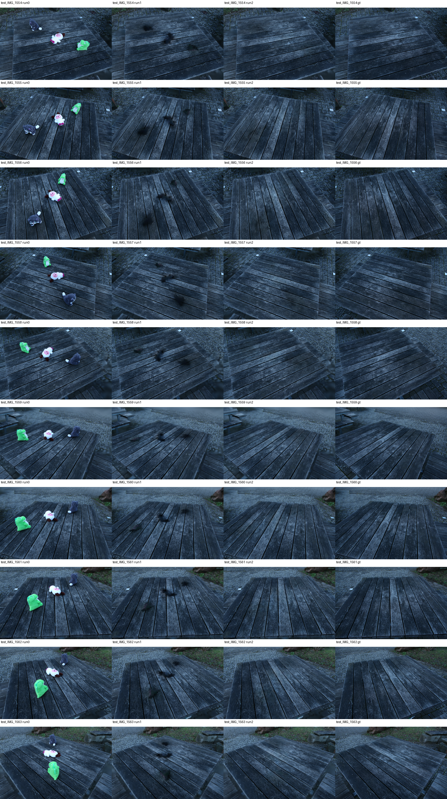
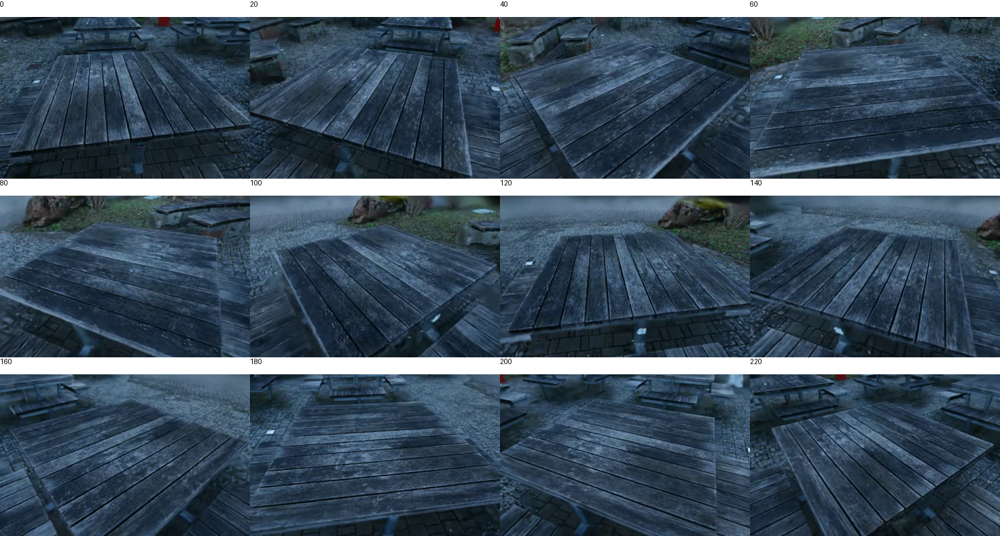

# MVP-B：三个玩具的手工 Mask 修复基线

2026-10-13。用户确认删除灰色、粉白、绿色三个玩具（ID 23/28/27），保留桌面和其余背景。用户完成第 18 帧补选并重新跟踪；30 帧原始标签与最终补全输入已检查、冻结。

## 受控对照

对象感知 iteration_2000 checkpoint 共 211981 个 Gaussian；最终删除 7088 个。修复开始前逐元素核对与 Run 1 相同的删除并集，exact_match=true。三组模型均在同一 10 个清场相机渲染，并与真实 test_IMG_1554–1563 对照；使用官方 unseen_mask，仅按区域内实际 RGB 像素计算 MSE/PSNR，mask 最近邻缩放。

| 模型 | 修复区 PSNR | 非修复区 PSNR | 全图 PSNR |
|---|---:|---:|---:|
| 仅删除 | 15.168 | 27.825 | 26.656 |
| 手工 Mask 修复 | 23.419 | 27.543 | 27.422 |

10/10 修复区改善，逐视角增益 7.70–9.11 dB。非修复区 9/10 下降（最差 -0.58 dB），1/10 改善；汇总下降 0.282 dB。这是周边背景退化的证据，不能宣称背景完全不变，也不能仅由区域均值判断每处桌面都受损。官方 unseen_mask 外区域不是经过语义核验的完整保护区。

## Mask 与默认流程的区别

补选后标签 4 在末段分裂成小分量。默认 enlarge 的 min_area=50 会删除这些有效标注（第 24 帧 45/104 像素，第 29 帧 28/41 像素）。本轮使用所有非零标签并集、min_area=0、原有 10 像素扩张；原始/处理后 Mask 分别保存并记录哈希。此参数偏离官方默认值，因此称为手工 Mask 修复基线，不称为未经修改的默认流程复现。LaMa、融合与 Gaussian 优化损失未修改。

## 视觉检查与验收

全部 10 清场视角并排检查，三个玩具基本移除，黑斑明显消除，板缝整体延续；仍有模糊、局部纹理/色差。240 帧、30 fps 视频全部成功解码，每 20 帧轨迹抽查未见目标重现或大面积黑斑。抽样不能排除短时闪烁，用户已播放检查并确认动态验收通过。

[RGB 轨迹视频](rgb_review.mp4)

当前结论：多目标修复在这个低分辨率短训练样本上有效，但存在非修复区轻微定量退化。用户已确认 MVP-B 动态验收通过；最终交付审计见 ../../ACCEPTANCE.md。不调整纹理算法。

## 产物与运行记录

远程独立目录：output/mvp-toys-manual-20261013。最终模型：model/point_cloud_object_inpaint_virtual/iteration_5000/point_cloud.ply。原实验和部署未覆盖。

修复优化及其后续官方渲染 125.0 秒，PyTorch 峰值 allocated 1.16 GiB，reserved 1.31 GiB；不是整条管线时间或整卡峰值。基础分辨率因子 8、基础训练 1000 步、特征蒸馏 2000 步、修复 5000 步，不能用于论文质量复现声明。

run-remote.sh 为本轮实际执行脚本快照，依赖远程冻结产物与既有环境，不是全新机器的一键安装脚本。逐视角结果、删除集合核对、Mask 预处理与运行资源记录见本目录 JSON/CSV。

## 交付补查

另已对 15 个带物体留出相机分别渲染 Run 0/1/2，保存于远程 holdout-comparison/，相机及模型身份见 holdout-manifest.json，本地 holdout-comparison.png 提供并排图。此组 GT 带有玩具，不用于清场区域真实性 PSNR。

动态验收已获用户确认通过。联合区域指标与下述分目标诊断分别报告，均不能替代完整语义保护区验收；当前视觉结果与数值证据未证明高保真产品完成。历史训练和 LaMa 步骤未记录完整实时峰值 GPU 显存，不能事后以优化峰值冒充全流程峰值。

## 用户动态验收

用户于 2026-10-13 明确回复“通过”，MVP-B 动态视觉验收通过。此确认不改变已报告的非修复区 0.282 dB 退化、局部纹理误差及低分辨率实验限制。

## 分目标独立补查

用删除前保存的各目标 PLY 在相同清场相机单独渲染，将颜色临时设为白色（仅内存，不修改源 PLY），以累积亮度 >0.05 的支持区域与官方 unseen_mask 相交，获得各目标评测区域。区域由修复输出之外的输入确定；这是目标投影支持的估计，不是人工核验的语义 GT。

| 目标 | 仅删除 PSNR | 修复 PSNR | 改善视角 |
|---|---:|---:|---:|
| 灰色 ID 23 | 19.597 | 25.478 | 10/10 |
| 粉白 ID 28 | 11.661 | 21.242 | 10/10 |
| 绿色 ID 27 | 17.693 | 24.238 | 10/10 |

指标按有效像素计算，与联合区域的分母不同，不可直接相加或替代联合指标。每个目标均有独立改善证据，区域阈值仍是诊断选择，不构成高保真质量门槛。见 targets.json 和 scripts/mvp/evaluate_targets.py。官方 render 的 override_color 分支存在未初始化 sh_objs 问题，本脚本使用白色 SH 渲染绕过，不修改官方渲染器。

## 复查归档

provenance.json 保存远程源模型、分类器、删除模型、修复模型的文件大小与 SHA-256。reproduction-evidence.tar.gz 已在本地校验哈希，包含部署 commit/工作树补丁、Python 包清单、GPU 信息、env.sh、实验配置、逐目标删除数组、冻结 Mask 与各步骤日志。大型 PLY 保留在远程原路径，未放入 Git 工作树。delivery-manifest.json 列出本地交付物哈希。

历史完整链路峰值显存未记录；另已完成七个步骤的独立资源复跑，见 ../resource-replay/README.md。它提供资源可行性证据，不补造历史峰值，也不是一次新的端到端质量复现。
