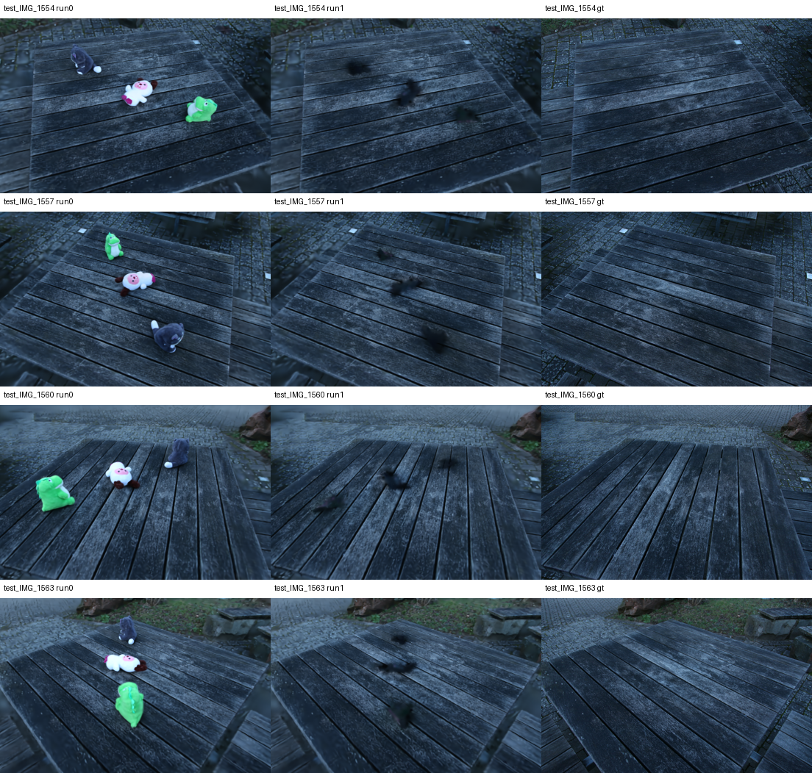

# MVP-B：toys 三目标准备

用户确认删除三个玩具，保留桌面和其余背景。
基础训练 1000 步、对象蒸馏 2000 步、分辨率因子 8，与 MVP-A 初步设置一致。
数据包含 120 个带物体视角、10 个清场视角，清场图与 unseen_mask 名称完全匹配。

二维分割原始尺寸为 367×238，相机采用 ceil 得到 368×238，首次关联失败。
原标签已备份，以最近邻对齐尺寸后，关联和蒸馏完成；尺寸修正记录在远端
`output/mvp-toys-20261013/mask_alignment.json`。

多视角编号图核验目标：灰色 ID 23、粉白 ID 28、绿色 ID 27。
分别计算阈值/凸包/最终 mask，删除 2921、1805、2362 个 Gaussian；并集
7088 个，无两两重叠，原始 211981 个剩余 204893 个。保留 PLY 逐行逐字段
等于源 PLY 的 mask 补集（`removal_report.json`），没有大凸包整体删除。
ID 30 未作为额外删除目标。

抽查四清场视角玩具主体已删除、桌面整体保留，留下三处黑斑，尚不能证明
没有全部边缘误删。正式多目标修复及其效果仍未验收。

30 个官方虚拟视角已生成，修复配置使用官方轨迹，不预先开发分区轨迹。
下载 [images.zip](images.zip)，保持文件名，在跟踪工具上传后分别标注三个
黑斑为三个对象，使用 Add new object 切换对象，最后统一 Start Tracking。
跟踪完成后需核验各帧三个区域及官方预处理的 palette 极性。

远端独立实验目录：`output/mvp-toys-20261013`。所有模型、逐目标 mask、
配置和日志存于该目录。bag 的模型及人工 mask 快照未覆盖。
